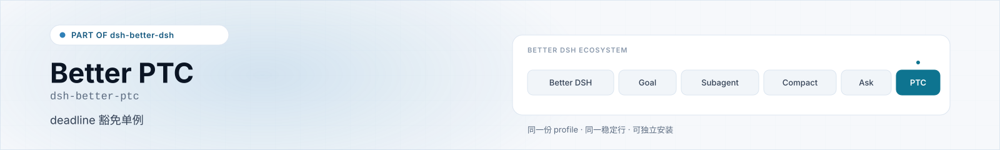
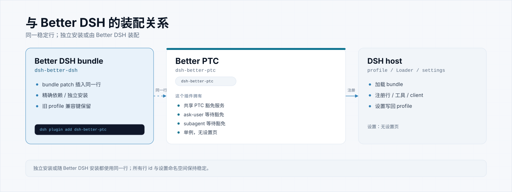

<p align="center">
  <picture>
    <source media="(prefers-color-scheme: dark)" srcset="https://raw.githubusercontent.com/omdsh-dev/dsh-better-ptc/main/docs/assets/banner-dark.svg">
    
  </picture>
</p>

<h1 align="center">dsh-better-ptc</h1>

<p align="center">一个共享的 PTC deadline 豁免单例，让等待工具不消耗 run_code 的 elapsed budget。</p>

<p align="center">
  <a href="https://www.npmjs.com/package/dsh-better-ptc"></a>
  <a href="LICENSE"></a>
  <a href="package.json"></a>
  <a href="https://github.com/omdsh-dev/dsh-better-dsh"></a>
</p>

<p align="center">
  <a href="https://github.com/omdsh-dev/dsh-better-dsh">Better DSH 插件集合</a> ·
  <a href="#安装">安装</a> ·
  <a href="#它拥有什么">它拥有什么</a> ·
  <a href="#设置">设置</a> ·
  <a href="#与-better-dsh-的关系">与 Better DSH 的关系</a>
</p>

## 它做什么

- 共享的 PTC 豁免服务
- 覆盖 `wait_subagent` / `ask_user_question`
- 注册 `exit_plan_mode` 的无限期等待
- ask-user 与 subagent 共用同一实例

<p align="center">
  <picture>
    <source media="(prefers-color-scheme: dark)" srcset="https://raw.githubusercontent.com/omdsh-dev/dsh-better-ptc/main/docs/assets/ownership-dark.svg">
    
  </picture>
</p>

## 安装

```sh
# 只安装这个插件
dsh plugin --profile <profile> add dsh-better-ptc@0.2.1

# 或安装 Better DSH（会自动带上所有独立插件）
dsh plugin --profile <profile> add dsh-better-dsh@0.11.4
```

> 安装 / 升级 / 换包后必须重启对应 profile；只刷新网页不够。

## 它拥有什么

| | |
|---|---|
| 稳定行 id | `dsh-better-ptc` |
| 入口 / 工具 | PTC 豁免服务 · `exit_plan_mode` 等待 · 无设置页 |
| 设置 | 无设置页；单例服务 |
| npm 包 | `dsh-better-ptc@0.2.1` |
| 仓库 | https://github.com/omdsh-dev/dsh-better-ptc |

## 设置

Better PTC 没有设置页；它是一个共享单例服务。

- ask-user 与 subagent 注册到同一服务；重复插入同一行 id 只激活一份。
- 计划审批无限期等待、不自动批准；外层取消、会话中断和卸载仍然有效。

## 与 Better DSH 的关系

- **同一个稳定行**：独立安装或由 `dsh-better-dsh` 装配，行 id 和设置命名空间都不变。
- **旧入口兼容**：早期 Apollo 集成使用的行配置键仍然注册，指向同一份配置。
- **可以单独使用**：不安装 Better DSH 也能工作；只是不会得到工程预设、流程技能或后台 job 守卫。
- **Apache-2.0**：本仓库与 Better DSH 的其他仓库统一使用 Apache License 2.0。

## 开发

```sh
npm test        # 单元 / 组件测试
npm run smoke   # 如仓库提供运行时冒烟
```

实现与测试说明见 [docs/DEVELOPMENT.md](docs/DEVELOPMENT.md)。

## 许可

[Apache License 2.0](LICENSE)。
